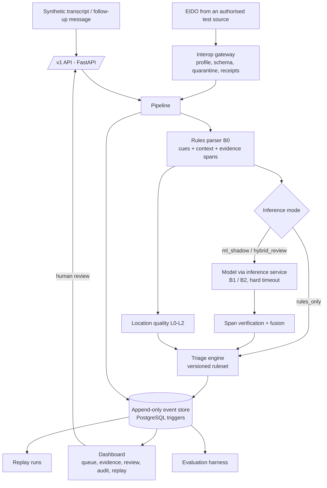

# System overview

How the research platform is put together today. The target design is
[technical-design-v1.2.md](../design/technical-design-v1.2.md); this page
describes what exists. Decisions behind it are in the
[decision log](../design-decisions/decision-log.md).

> Research simulation only: synthetic data, advisory output, a human in the
> loop. It routes no calls, dispatches nothing and is not NG911 certified.

## Components

| Area | Code | Role |
|---|---|---|
| Contracts | `backend/src/ntip/schema` | Versioned Pydantic models in three layers (source, canonical, advisory) plus reviews, audit events and replay runs; published as JSON Schema 2020-12 in `backend/schemas/` |
| Parser (B0) | `backend/src/ntip/parser` | Word-bounded cue matching, polarity/tense/attribution, victim counts, every reported location; every fact quotes its source span |
| Location | `backend/src/ntip/location` | Missing / incomplete / conflicting / verified (levels L0-L2) |
| Triage | `backend/src/ntip/triage` | Severity only from reported conditions via pinned rulesets; everything else becomes review actions (DDL-013) |
| ML | `backend/src/ntip/ml` | Inference contract, span verification, fusion modes, inference service, B1 (scikit-learn) and B2 (Claude, opt-in) |
| Store | `backend/src/ntip/store` | Append-only event store, in-memory or PostgreSQL with mutation-blocking triggers and reversible migrations |
| Pipeline | `backend/src/ntip/pipeline.py` | Ingest, idempotency, fail-safe processing, reviews, projected state |
| API | `backend/src/ntip/api` | `/v1` incidents, reviews, replay, rulesets, model outputs, interop; OpenAPI published |
| Interop | `backend/src/ntip/interop` | Pinned NENA EIDO profile, validation, import gateway, receipts |
| Evaluation | `backend/src/ntip/evaluation`, `ntip.generator` | Labelled datasets, metrics with intervals, calibration, comparisons, latency; synthetic scenario generator |
| Dashboard | `apps/dashboard` | React + TypeScript on generated API types |

## Data flow for one message

1. The API (or the interop gateway) receives a synthetic message; an
   `Idempotency-Key` makes retries safe.
2. The pipeline stores it as an immutable `SourceEvent` and re-parses the whole
   conversation into a new `Incident` version.
3. Depending on the inference mode, a model proposes candidates; only those
   whose quote matches the source are fused, and only ever added.
4. The triage engine produces an `Assessment`: severity band, location quality,
   review actions, research priority (P0-P4) and every rule that fired.
5. Source, incident version, model output, assessment and audit events are
   appended in one batch. A failure stores the source and a
   `processing_failed` assessment that demands urgent review.
6. Operators see the evidence and confirm, correct or override; the review is a
   separate record and never changes the assessment.

## Where to look next

- Safety rules and their tests: [safety case](../safety/safety-case.md); risks: [threat model](../safety/threat-model.md)
- Results: [evaluation results](../evaluation/results/README.md); models: [B1](../ml/model-card-b1.md), [B2](../ml/model-card-b2.md)
- Standards position: [NG911 alignment](../standards-alignment/ng911-alignment.md), [source register](../standards-alignment/source-register.md), [interop verification](../standards-alignment/interop-verification.md)
