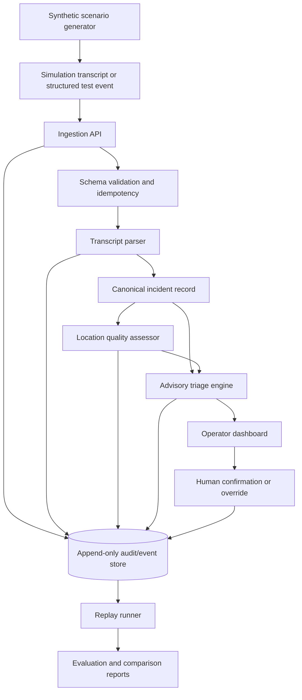
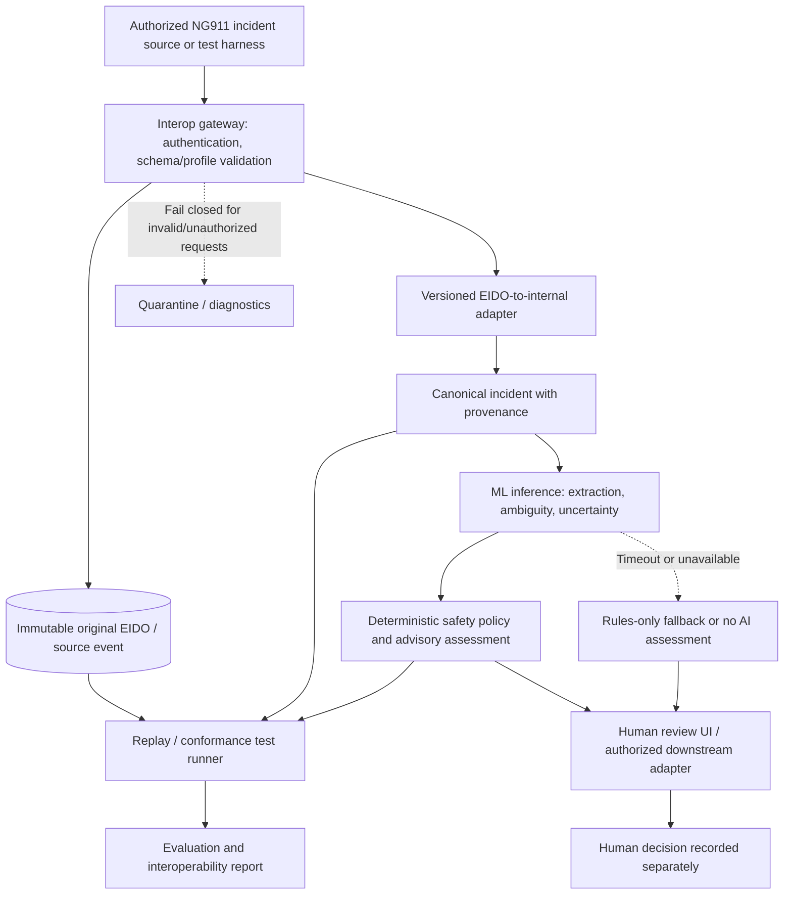

# NG911 Triage Intelligence Platform
## Detailed Technical Design Document

**Document status:** Proposed engineering specification — reconcile against the current repository before marking implemented  
**Version:** 1.2 (ML-first, NG911 interoperability-first design proposal)  
**Date:** November 9, 2026  
**System:** `ng911_triage_intelligence_platform`  
**Intended audience:** Maintainers, engineering reviewers, public-safety domain advisers, researchers, and future collaborators

> **Safety and scope notice:** This is a research and simulation platform. It is not certified for emergency operations, not a 911 call-routing service, not a substitute for trained telecommunicators or approved dispatch protocols, and not asserted to be NENA i3 compliant. All demonstrations and benchmarks must use synthetic or appropriately authorized, de-identified data. The architecture below describes design targets, not independently verified properties of the current codebase.

---

# 1. Executive Summary

The NG911 Triage Intelligence Platform (NTIP) is a modular, human-in-the-loop research platform for converting unstructured emergency-call-like narratives into structured incident records, generating *advisory* urgency assessments, surfacing missing or conflicting location information, and evaluating decisions through immutable event history and reproducible replay. It is proposed as an optional, standards-oriented extension to the emerging U.S. Next Generation 911 (NG911) ecosystem, positioned downstream of authorized call-handling and incident-data exchange interfaces—not inside critical call-routing functions.

**Core hypothesis:** A hybrid machine-learning and deterministic safety pipeline, with calibrated uncertainty and human review, can improve extraction of actionable facts from ambiguous synthetic emergency narratives compared with rules-only baselines. This is a hypothesis requiring experimental validation. A structured, explainable, versioned pipeline can make simulated emergency incident interpretation and review more reproducible and inspectable than an opaque, unversioned classification pipeline. Whether it improves operational outcomes must be established separately through controlled evaluation and qualified practitioner validation.

**Primary outcomes:**

1. **Interpretation:** Preserve source statements and extract actionable, uncertainty-aware incident facts.
2. **Decision support:** Surface urgency cues and suggested review order without silently automating dispatch decisions.
3. **Location quality:** Distinguish the reported location, validated location, routing location, and response location.
4. **Accountability:** Explain every transformation and record human corrections.
5. **Research reproducibility:** Compare rules, parser versions, and evaluation datasets under controlled conditions.
6. **Standards-oriented interoperability:** Import and export appropriately versioned emergency incident information through documented adapters, while keeping AI output advisory and preserving authoritative source records.
7. **Noninterference:** Ensure the AI subsystem can fail, time out, or be disabled without blocking upstream NG911 routing, call handling, or authorized incident exchange.

**Explicit non-goals:** Receiving live 911 calls, SIP/i3 call handling, NGCS routing, ECRF/LVF implementation, dispatch authorization, medical diagnosis, autonomous dispatch, direct PSAP deployment, or certified NG911 interoperability.

# 2. Problem Definition and Design Context

## 2.1 Operational problem

Emergency-call-like narratives may be fragmented, noisy, contradictory, multilingual, or location-incomplete. An operator may need to determine the reported event, its immediate risk indicators, where it is occurring, what remains unknown, and whether newly received details change the situation. In a simulation environment, these questions can be represented as machine-readable facts, hypotheses, and outstanding verification requests.

The system should **not** assume that current PSAPs universally lack triage protocols, CAD tools, recording systems, or quality-assurance processes. Existing capabilities vary by agency and vendor. The research opportunity is to evaluate a specific, reproducible design for explainable, inspectable decision-support assistance, not to claim that emergency communications lacks such functionality altogether.

## 2.2 NG911 relationship

NG911 is a standards-driven transition toward IP-based emergency communications and geospatially informed routing. The platform is a **downstream simulation and decision-support research layer**, not an implementation of the NENA i3 core-services architecture. It borrows relevant concerns: data provenance, structured interchange, location quality, interoperability boundaries, and reliable event processing.

The project's incident schema is **project-defined**. It must not be described as an official NENA incident schema. Any mapping to NENA interfaces, GIS layers, or other public-safety data standards requires a separate, version-specific conformance mapping and test suite.

## 2.3 Users and stakeholders

| Role | Needs | Permissions in research prototype |
|---|---|---|
| Simulation operator | Inspect incidents, see evidence, correct classifications | View, annotate, override advisory suggestions |
| Evaluator/researcher | Run datasets, compare versions, inspect failures | Run and export de-identified experiments |
| Maintainer | Configure services, deploy, diagnose failures | Administer test environment |
| Domain reviewer | Assess safety and operational plausibility | Read-only scenarios, provide documented feedback |
| External integrator (future) | Consume stable data contracts | Restricted, explicitly approved API access |

## 2.4 Design success criteria

- A single synthetic transcript produces a valid incident record, evidence references, advisory assessment, and audit events.
- Every important extracted assertion can be traced to a source span or explicit rule.
- Missing location does not lower the underlying severity of a life-threatening report.
- The same dataset and pinned software/configuration versions produce identical deterministic outputs.
- A human override never destroys the original machine assessment.
- The system fails safely: parsing or scoring failures surface as **needs human review**, never as a silent low-priority outcome.
- A fresh contributor can reproduce the demo and evaluation results using documented commands.

# 3. Architecture and Boundaries

## 3.1 Logical architecture



**Critical boundary:** The dashboard is a review interface, not an actuator for real dispatch. No production emergency network connections are included in the reference deployment.

## 3.2 Proposed monorepo

```text
ng911_triage_intelligence_platform/
├── apps/
│   ├── dashboard/                    # Operator-style research interface
│   └── simulator/                    # Optional controlled scenario runner
├── services/
│   ├── ng911-interop-gateway/          # EIDO intake/export; isolated standards boundary
│   ├── ingestion-api/                # HTTP boundary, validation, orchestration
│   ├── transcript-parser/            # Extraction, negation, provenance
│   ├── prioritization-engine/        # Advisory rules, explanations
│   └── audit-service/                # Optional extracted service; begin in API
├── packages/
│   ├── ng911-interop/                # EIDO adapters, versioned profiles, conformance fixtures
│   ├── incident-schema/              # JSON Schema, validation, versioning
│   ├── shared-types/                 # Generated TS types / contracts
│   ├── location-validator/           # Location completeness and consistency
│   ├── test-data-generator/          # Synthetic scenario creation
│   ├── replay-engine/                # Deterministic replay primitives
│   └── evaluation-harness/           # Metrics and regression reports
├── data/
│   ├── fixtures/                     # Curated labeled synthetic cases
│   └── generated/                    # Ignored or carefully versioned outputs
├── docs/
│   ├── architecture/
│   ├── adr/                          # Architecture decision records
│   ├── standards-alignment/          # Traceability matrix and standards source register
│   ├── evaluation/
│   ├── safety/
│   └── operations/
├── infra/
│   └── docker/
└── .github/workflows/
```

The folder names above are a **target organization**, not a claim that each folder currently exists. Do not create separate network services merely to mirror directory names. Begin with a modular monolith where appropriate, extracting services only when independent scaling, ownership, or isolation is justified.

## 3.3 Technology decisions

| Layer | Proposed choice | Why | Alternative and trade-off |
|---|---|---|---|
| Shared contracts | JSON Schema + generated TypeScript | Runtime validation and cross-package agreement | TypeScript interfaces alone lack runtime guarantees |
| Core backend | Node.js + TypeScript | Existing stack continuity, typed end-to-end workflow | Python/FastAPI stronger for ML experimentation but adds migration cost |
| HTTP API | Fastify or existing framework | Typed request validation, OpenAPI support | Express is fine if already established |
| UI | React + TypeScript | Shared types, rapid research UI iteration | Separate UI stack adds overhead |
| Database | PostgreSQL | Transactions, JSONB, append-only audit modeling | In-memory store only for local tests |
| Spatial checks | PostGIS in later phase | Real spatial predicates and GIS imports | String/coordinate checks alone are not authoritative validation |
| Queue | In-process initially | Simpler deterministic prototype | Redis/message broker only after measured need |
| Evaluation | TypeScript harness; optional Python | Keep deterministic baseline unified | Python appropriate for notebooks, statistics, model serving |
| Local deployment | Docker Compose | Reproducible services and database | Kubernetes premature for prototype |

**Recommendation on Python:** Keep the established TypeScript services unless profiling or ML requirements justify a specific Python component. A future `research/python/` package can ingest exported, versioned datasets and return model predictions through a stable contract. Never migrate solely for perceived prestige.

# 3A. Machine Learning Intelligence Layer (Core Research Component)

**Status:** Proposed, not asserted to exist in the current repository. This section defines the ML workstream as a first-class component of the platform. Its presence in the design must not be confused with completed experiments or operational validation.

## 3A.1 Research objective and boundaries

The primary ML research question is: **Can uncertainty-aware language models extract safety-relevant facts from ambiguous emergency narratives more accurately than a deterministic parser, while abstaining on unsupported claims and maintaining a traceable evidence chain?** The project investigates *assisted information extraction*, not automated dispatch, clinical diagnosis, or replacing established emergency medical dispatch protocols.

The system should evaluate four complementary tasks:

1. **Structured incident extraction:** multi-label incident type, symptoms and hazards, victim count, temporal indicators, negations, and caller-reported facts.
2. **Critical cue recognition:** identify potential immediately dangerous conditions (e.g., possible impaired breathing) with high recall and explicit uncertainty, without assigning clinical diagnoses.
3. **Location entity extraction:** recognize reported addresses, landmarks, intersections, apartment/floor details, conflicting statements, and missing response-location elements. A language model must never invent coordinates or mark an unverified address as validated.
4. **Uncertainty estimation and selective abstention:** identify fields whose supporting evidence is insufficient; route them for human verification rather than guessing.

## 3A.2 Logical architecture

```text
Synthetic transcript / authorized, appropriately de-identified transcript
      |
      v
Input sanitizer + language detection + schema validation
      |
      +---------------------> Rules-only baseline parser
      |
      v
ML inference service (versioned model + prompt/weights + tokenizer)
      |  |-- multi-label event and hazard extraction
      |  |-- critical-cue detection
      |  |-- location-entity extraction
      |  `-- confidence / abstention assessment
      v
Evidence-grounded candidate facts (source spans + confidence + provenance)
      |
      v
Schema validator + contradiction detector + policy/safety constraints
      |
      +--> needs-review / abstained fields / operator questions
      |
      v
Structured incident record (ML hypotheses distinguished from verified facts)
      |
      v
Safety-constrained advisory prioritization + human review
      |
      v
Immutable audit event + model/version metadata + replay/evaluation
```

The rules-only parser remains a permanent baseline and fallback. The ML model must not directly mutate incident records or issue dispatch instructions; its output is a candidate interpretation that must pass schema, provenance, and safety validation.

## 3A.3 Deployment and repository design

Preserve the existing TypeScript/Node API and monorepo. Add a Python service for training and inference where ML tooling offers clear advantages:

```text
services/ml-inference/                 # Python, FastAPI (proposed)
  app/api.py                          # /v1/infer, /health, /model-info
  app/inference.py                    # model adapter and output validation
  app/calibration.py                  # field-level confidence and abstention
  app/safety.py                       # no fabricated evidence / guardrails
  models/                             # model manifests, not unlicensed weights
  tests/
research/ml/
  datasets/README.md                  # provenance, licensing, splits
  labeling-guidelines.md
  train.py
  evaluate.py
  calibrate.py
  compare_baselines.py
  experiments/                       # reproducible configuration manifests
packages/incident-schema/            # shared JSON Schema / generated TS + Python types
```

The TypeScript ingestion API calls ML inference over an internal authenticated HTTP endpoint. Keep the inference boundary stateless; persistent event storage remains owned by the ingestion/audit services. Support feature flags (`rules_only`, `ml_shadow`, `hybrid_review`) and timeouts with safe fallback. In `ml_shadow`, ML predictions are evaluated but not shown as operational recommendations.

## 3A.4 Model strategy and comparison baselines

Begin with three baselines rather than immediately fine-tuning a large model:

- **B0:** existing deterministic parser and keyword/negation rules.
- **B1:** an openly licensed small encoder or sequence-labeling model for classification and entity extraction.
- **B2:** a structured-output language model using zero-/few-shot prompting with strict JSON Schema validation.

A **B3 domain-adapted model** may be trained only after dataset quality and baseline gaps are established. Options include fine-tuning a compact open-weight model or a task-specific encoder. Record licensing, training data rights, inference cost, model size, model hash, prompt version, and deployment constraints. Do not claim the model is novel merely because it is fine-tuned; novelty must be demonstrated by a distinctive method and measurable comparative results.

## 3A.5 Inference API and data contract

`POST /v1/infer` accepts `{ incident_id, transcript, language_hint?, model_version, request_id }`. The response is a **candidate**, never a final dispatch decision:

```json
{
  "incident_id": "synthetic-001",
  "model_version": "extractor-v0.1.0",
  "schema_version": "incident-v1",
  "candidates": [
    {
      "field": "critical_cues.possible_breathing_distress",
      "value": true,
      "confidence": 0.88,
      "source_span": {"start": 31, "end": 53},
      "evidence_text": "not breathing properly",
      "status": "unverified_model_hypothesis"
    }
  ],
  "abstentions": [
    {"field": "response_location", "reason": "insufficient_location_evidence"}
  ],
  "contradictions": [],
  "model_runtime_ms": 73
}
```

*Illustrative values only; not measured system performance.* The API must validate source-span offsets against the original transcript and reject outputs whose `evidence_text` does not match. Confidence values must not be interpreted as calibrated probabilities until calibration is empirically established. Store evidence spans and provenance for every ML-extracted claim; preserve distinctions among caller statement, model inference, and operator confirmation.

## 3A.6 Safety constraints and decision fusion

1. **No silent downgrades:** Missing or uncertain location data must never reduce an otherwise high-severity cue. Location quality influences verification workflow, not physiological or threat severity.
2. **No fabricated facts:** A model output lacking a matching source span is unsupported and must be rejected or marked for review.
3. **High-risk contradictions:** If the ML and rules-based detectors disagree on a critical cue, preserve both findings and escalate to review. Do not average away the critical signal.
4. **Abstention is allowed:** A missing victim count, unknown weapon status, or ambiguous phrase should remain unknown; `unknown` must not be converted into `false`.
5. **Human authority:** Recommendations are advisory; operators retain responsibility for classification and dispatch decisions. No autonomous dispatch actions.
6. **Fail safe:** On timeout, invalid JSON, model unavailability, or confidence failure, use the existing rule-based pipeline and visibly indicate degraded inference.
7. **Prompt injection resistance:** Treat transcript text as untrusted content, never as instructions to the inference service. Structured validation and privilege separation are mandatory.

## 3A.7 Data generation, annotation, and governance

Initial development uses **synthetic incident narratives**, with systematic variations in speech disfluency, negation, accents expressed in text, spelling errors, indirect symptom descriptions, multiple speakers, missing locations, and contradictory updates. Synthetic examples should be designed and reviewed to avoid stereotypes or disproportionate error rates across language varieties.

Develop an annotation manual with: incident class, evidence spans, critical-cue labels, negation scope, location components, uncertainty class, and review priority. Labeling must distinguish *what was reported* from *what is medically or operationally verified*. For research-grade evaluation, obtain independent annotation from at least two qualified reviewers on a subset, adjudicate disagreements, and report inter-annotator agreement. Seek public-safety subject-matter review before treating labels as operationally meaningful.

Keep **train, validation, and test partitions disjoint by scenario template and paraphrase family** to prevent leakage. Add a separate held-out challenge set containing novel incident compositions. Do not train on test cases, and do not publish identifiable emergency-call data. Real PSAP data requires appropriate permissions, privacy review, and data-use agreements.

## 3A.8 Evaluation plan and pre-registered hypotheses

| Research question | Metrics | Baseline | Failure condition |
|---|---|---|---|
| Does ML improve fact extraction? | Per-field precision, recall, macro/micro F1, exact span match | B0 rules | No gain on held-out scenarios or degraded critical recall |
| Are urgent cues missed? | Critical-cue sensitivity, false-negative rate, error taxonomy | B0 rules | Critical omissions exceed predeclared tolerance |
| Can the model know when not to guess? | Calibration error, Brier score, risk-coverage curve, abstention rate | Always-predict model | Unsupported high-confidence predictions persist |
| Does fusion help? | Hybrid vs rules-only vs ML-only, with confidence intervals | B0, B1, B2 | Fusion increases unsafe omissions |
| Is the system reproducible? | Replay agreement, hash/version match | Frozen baseline | Same input/model/config produces unexplained changes |
| Is inference practical? | p50/p95 latency, timeouts, CPU/GPU cost | Rules-only | Latency or cost exceeds agreed research budget |

Report bootstrap confidence intervals where appropriate, class prevalence, confusion matrices, and slice performance for negation, ambiguous locations, language variation, and multi-victim narratives. Evaluate **critical false negatives separately** from aggregate F1; high overall accuracy can conceal unacceptable failures on rare, dangerous events. Run ablations removing provenance validation, abstention, rules fusion, and location handling to establish which components contribute meaningful gains.

The initial paper must report **no fabricated performance results**. Results sections should remain explicitly pending until experiments have been executed with frozen datasets and reproducible manifests.

## 3A.9 Experiment tracking and reproducibility

Every evaluation run records: git commit, dataset manifest and hash, model identifier and weights hash, tokenizer version, prompt hash, inference settings, seed, environment/dependency lockfile, schema version, label-guide version, and scoring-rule version. The replay service must distinguish deterministic rules from potentially nondeterministic generative outputs. For generative models, store the original model response and use *recorded-output replay* for exact audit, with *fresh-inference replay* clearly labeled as a separate experiment.

## 3A.10 Delivery milestones and acceptance gates

- **ML-1 — Dataset and baseline:** publish a documented synthetic dataset, label guide, leakage-safe split, and rules-only benchmark. Gate: baseline metrics reproducible from a single command.
- **ML-2 — Inference contract:** implement the Python inference adapter, shared schema validation, source-span verification, and failure fallback. Gate: no unsupported extracted claim silently enters the verified incident fields.
- **ML-3 — Comparative modeling:** evaluate at least one task-specific model and one structured-output LLM against the baseline. Gate: publish complete results including failures, latency, and uncertainty measures.
- **ML-4 — Calibrated hybrid:** implement selective abstention, disagreement routing, and versioned rule/ML fusion. Gate: demonstrate no increase in critical-cue false negatives on a frozen test set, or explicitly report that the gate was not met.
- **ML-5 — Research release:** publish code, reproducibility instructions, model cards, dataset limitations, evaluation report, and independent review feedback where obtainable. Gate: another engineer can reproduce published aggregate findings.

## 3A.11 What can and cannot support an EB-2 NIW narrative

The proposed endeavor can be framed as research into **reliable, auditable AI-assisted interpretation of emergency communications**, with potential relevance to public safety and NG911 modernization. The **national importance** argument should be grounded in the emergency communications problem and credible plans for broader dissemination or adoption, not merely in the fact that the code uses AI or mentions NG911.

Strong evidence would include independent benchmarking, external expert evaluation, accepted peer-reviewed publication, reproducible open-source artifacts, adoption or pilots with qualified stakeholders, and documented improvements over established baselines. A self-authored paper, personal repository, or model fine-tune by itself does not prove impact, national importance, or that the applicant is well positioned to advance the endeavor. Distinguish planned research from completed work and independently verified outcomes throughout the petition.

---


# 3B. NG911 Interoperability and Extension Architecture (Core Product Requirement)

## 3B.1 Intended integration model and boundaries

NG911 modernization in the United States is an ecosystem of standards, implementations, governance bodies, emergency communications centers, and vendors—not a single federal codebase to fork or replace. The platform proposes an **optional AI decision-support extension** that consumes incident information from an *authorized* NG911-compatible application or test harness, processes it outside the call-routing critical path, and presents a versioned, nonbinding assessment to an authorized application or operator. The platform must not imply endorsement, procurement, certification, or adoption by federal, state, local, or NENA bodies.

The preferred boundary is **incident information exchange**, including the NENA Emergency Incident Data Object (EIDO) family, subject to verifying the exact standard edition, schema, conveyance profile, and deployment context. NENA i3 defines broader NG911 architecture, but an EIDO-capable adapter alone does **not** establish i3 conformance. The Emergency Services IP Network (ESInet), NG911 Core Services (NGCS), Emergency Call Routing Function (ECRF), Location Validation Function (LVF), call handling, and official CAD/dispatch decisions remain outside this product's authority.



**Noninterference invariant:** Failure of B–M must not interrupt or delay an external NG911 system's call routing, call handling, or mandatory incident processing. Integration must be asynchronous or otherwise bounded by a separately agreed latency budget. No writeback into authoritative records is permitted by default.

## 3B.2 Standards and public implementation research register

The following are **candidate source families**, not evidence of implemented compatibility. Verify exact document identifiers, release dates, normative clauses, schema artifacts, licenses, and applicability in a maintained register before declaring any conformance result.

| Source / artifact | Relevance | Engineering action | Claim limit |
|---|---|---|---|
| NENA i3 / NG9-1-1 Solution standards | Architectural and interoperability context | Document which NG911 functions the extension does **not** implement | No general i3 compliance claim |
| NENA Emergency Incident Data Object (EIDO), NENA-STA-021 series | Structured emergency incident interchange | Pin supported EIDO edition and official schemas; map fields and identifiers | Schema support is not full NG911 conformance |
| NENA EIDO conveyance, NENA-STA-024 series | Exchange between authorized systems | Specify transport, authorization, acknowledgements, retries, and error behavior for selected profile | Do not assert full conveyance compliance without tests |
| NENA911 public repositories (https://github.com/NENA911) | Potentially relevant public schema/interface artifacts | Inspect licenses, release tags, issues, schemas, and test fixtures | Public repositories may be incomplete or non-normative |
| Texas A&M `ng911-dev` (https://github.com/tamu-edu/ng911-dev) | Public interoperability/conformance testing research | Inspect available test interfaces, supported NENA requirements, setup, and permitted reuse | Do not assert the test suite covers EIDO or this extension without checking |
| National 911 Program (https://www.911.gov/issues/ng911/) | Federal modernization context | Ground problem framing and ecosystem boundaries | Program guidance is not an integration API |

**Version-lock policy:** A release must declare `eidoStandardEdition`, `schemaArtifactDigest`, `conveyanceProfile`, `adapterVersion`, `internalSchemaVersion`, and `interopTestSuiteVersion` where applicable. Unsupported versions must produce explicit errors; never silently reinterpret unknown fields.

## 3B.3 Interoperability gateway responsibilities

The gateway is a trust-boundary component, not a replacement for NGCS or a generic webhook that implicitly claims NG911 compatibility. It must:

1. Accept only configured, authenticated sources in integration mode; simulation mode uses isolated credentials and synthetic fixtures.
2. Validate payload size, media type, structural schema, declared edition/profile, required identifiers, and timestamps before transformation.
3. Preserve the original bytes (or a cryptographically verifiable canonical representation), source identifier, receipt time, content digest, and validation results.
4. Map supported EIDO fields to internal schema through explicit, tested transformations; preserve unmapped data in a nonauthoritative opaque field where legally and technically permitted.
5. Enforce idempotency and ordering semantics by source event ID and source version; treat corrections as new events, not destructive rewrites.
6. Produce advisory assessments **outside** the authoritative EIDO object unless a specific permitted extension or downstream interface has been validated.
7. Isolate integrations by organization, environment, and credential; record every access and export.
8. Support configurable read-only mode, feature disablement, and bounded retry/dead-letter handling.

**Illustrative API design (project-defined, not a NENA-standard endpoint):**

```http
POST /v1/interop/eido/ingest
Authorization: Bearer <authorized-test-token>
Content-Type: application/json
X-Interop-Profile: <configured-profile-id>
Idempotency-Key: <source-event-id>
```

Response in simulation mode:

```json
{
  "receiptId": "rcpt_001",
  "status": "accepted_for_advisory_processing",
  "sourceDigest": "sha256:<digest>",
  "adapterVersion": "eido-adapter-0.1.0",
  "assessmentStatus": "pending"
}
```

The request body must be validated against the **actual pinned external schema**, not an invented EIDO example. HTTP 202 represents accepted *local* advisory processing, not an official NG911 acknowledgement. Proposed `GET /v1/interop/receipts/{receiptId}` returns status; `GET /v1/assessments/{assessmentId}` returns the separate advisory object. Production transport bindings, if any, require profile-specific design and authorization.

## 3B.4 Canonical model and reversible mapping

Maintain a three-layer representation:

- **Source layer:** Immutable external payload and source metadata, including authoritative IDs and revision lineage.
- **Canonical layer:** Project-specific normalized incident fields, evidence spans, uncertainty, location candidates, and source-field paths.
- **Advisory layer:** Model predictions, safety-rule findings, review requests, reason codes, model/rule versions, and human disposition.

For every mapped field, persist `{sourcePointer, sourceValueDigest, transformationId, transformationVersion, extractedValue, confidence, validationWarnings}`. Explicitly distinguish absent, unknown, conflicting, inferred, and confirmed values. A generated inference must never overwrite a caller statement or verified incident location. Round-trip testing should prove preservation of supported source fields; exact byte-for-byte regeneration is only promised if the original payload is returned unchanged.

**Advisory assessment contract (illustrative, project-defined):**

```json
{
  "assessmentId": "assess_001",
  "sourceReceiptId": "rcpt_001",
  "sourceEventId": "external-event-001",
  "assessmentSchemaVersion": "1.0.0",
  "modelVersion": "model-2026-11-experimental",
  "policyVersion": "policy-1.0.0",
  "signals": [{
    "code": "POSSIBLE_BREATHING_DISTRESS",
    "status": "suspected",
    "evidence": [{"sourcePointer": "/transcript", "start": 18, "end": 39}]
  }],
  "locationQuality": {"status": "requires_verification"},
  "advisoryPriority": "urgent_human_review",
  "abstainedFields": ["confirmed_diagnosis"],
  "humanDecision": null
}
```

The example is **not** an EIDO schema or a medical dispatch protocol. `advisoryPriority` is local to the research application and must never be treated as an official dispatch code.

## 3B.5 Integration modes and deployment topology

| Mode | Purpose | Data | External writes | Gate |
|---|---|---|---|---|
| A: Offline fixture | Reproducible developer tests | Synthetic EIDO-like and schema-valid test payloads | None | Local schema/unit tests |
| B: Standards conformance lab | Validate a pinned EIDO edition/profile | Approved test vectors | Test harness only | Contract and negative-case tests |
| C: Shadow advisory pilot (future) | Compare recommendations with authorized operational decisions | Governed, authorized data only | None | Legal/privacy review, domain approval, security assessment |
| D: Human-reviewed integration (future) | Display assessments in authorized workflow | Governed data | Only explicit, audited human-approved channels | Operational acceptance, safety case, vendor/agency approval |

Modes C and D are **future possibilities**, not planned live deployments without partners and approvals. An external system should be able to disable or remove this platform without changes to NG911 routing or mandatory incident handling.

## 3B.6 Security, privacy, and safety controls for integration

- Use mutual authentication or deployment-approved equivalent, least-privilege credentials, transport encryption, and tenant isolation.
- Treat incident narratives and location data as sensitive; do not send them to third-party model providers without explicit authorization, contractual safeguards, and a validated data-flow review.
- Require explicit policy for storage, retention, redaction, deletion, incident access, and audit access; never publish real emergency communications in a public repository.
- Treat transcripts and external JSON as untrusted input; defend against prompt injection, schema abuse, malicious links, oversized payloads, and model-output laundering.
- Apply timeouts, circuit breakers, resource quotas, and queue isolation so inference load cannot create backpressure in external emergency infrastructure.
- Default to no assessment when evidence is insufficient; never synthesize a confirmed location, diagnosis, or dispatch instruction.
- Require human confirmation for any action outside the research sandbox; support visible uncertainty and source-linked explanations.

## 3B.7 Interoperability verification matrix

| Test ID | Scenario | Expected result |
|---|---|---|
| INT-001 | Valid payload for pinned EIDO schema/profile | Accepted and transformed with traceable field mapping |
| INT-002 | Unsupported EIDO version | Explicit unsupported-version response; source quarantined or rejected |
| INT-003 | Missing required schema fields | Validation failure; no ML execution |
| INT-004 | Unknown optional fields | Preserve or explicitly flag per pinned profile; never silently discard |
| INT-005 | Duplicate event and idempotency key | Single logical intake; duplicate observable in logs |
| INT-006 | Out-of-order revisions | Preserve source history; no silent rollback |
| INT-007 | ML timeout or outage | Existing incident flow continues; fallback/no-assessment status visible |
| INT-008 | Contradictory or uncertain location | Urgency preserved; location verification surfaced separately |
| INT-009 | Untrusted instructions embedded in narrative | No execution of narrative instructions; extraction-only handling |
| INT-010 | Tenant A requests tenant B incident | Access denied and auditable |
| INT-011 | Round-trip of source data | Original immutable payload available; mapped fields traceable |
| INT-012 | Adapter upgrade / schema change | Versioned regression comparison and reproducible diff |

**Evidence requirements:** Store the official artifact version, test command, fixture provenance, pass/fail result, timestamp, code commit, and known gaps. A successful internal test suite supports a *limited* compatibility statement, not third-party certification.

## 3B.8 Research hypotheses and measurable contributions

- **RQ-INT1:** Does schema-preserving EIDO-to-incident mapping maintain completeness and provenance under revisions and ambiguous fields?
- **RQ-INT2:** Does an ML-assisted interpretation layer improve critical-cue recall and structured extraction over rules-only baselines on held-out synthetic incidents?
- **RQ-INT3:** Does calibrated abstention reduce unsupported high-confidence claims without an unacceptable loss of useful extraction?
- **RQ-INT4:** Can the extension operate within bounded latency while demonstrating zero blocking dependency on simulated NG911 routing/call-handling paths?
- **RQ-INT5:** Can independent developers reproduce compatibility and evaluation results from published fixtures, scripts, and pinned versions?

Report per-class precision/recall, critical-cue false-negative rate, calibration error, abstention coverage, location extraction accuracy, mapping completeness, adapter validation success, latency percentiles, timeout recovery, and failure isolation. Compare rules-only, ML-only (offline evaluation), and hybrid pipelines; perform ablations of provenance, uncertainty, and safety policies. Distinguish synthetic-benchmark findings from real operational benefits.

## 3B.9 Delivery plan and acceptance gates

**Phase I — standards traceability:** Select and pin exact EIDO and conveyance editions; build source register, requirement-to-test matrix, and license review. **Gate:** no unverified compliance language in README.

**Phase II — import-only adapter:** Implement `packages/ng911-interop`, schema validation, source preservation, mapping, idempotency, and 12 integration tests above. **Gate:** zero source mutation, explicit unsupported-version behavior, reproducible fixtures.

**Phase III — ML advisory attachment:** Run the inference layer asynchronously, produce standalone versioned assessments, and show evidence-linked explanations. **Gate:** failures do not block ingestion; critical-cue tests and abstention behavior pass.

**Phase IV — lab interoperability:** Evaluate against relevant publicly available NENA artifacts and any applicable Texas A&M test tooling *after confirming actual coverage and licenses*. **Gate:** publish exact supported profiles and failing requirements, not generic conformance claims.

**Phase V — external validation:** Obtain independent engineering and qualified emergency-communications review, refine the safety case, and publish a reproducible technical report. **Gate:** separate verified results from hypotheses and future integration aspirations.

## 3B.10 Architecture decisions and alternatives

**ADR-INT-001 — Integrate at incident exchange, not call routing.** Rationale: minimizes safety-critical coupling and aligns with advisory workflow. Alternative: intercept i3 call routing; rejected due to safety, authorization, and complexity.

**ADR-INT-002 — Separate source and AI assessment objects.** Rationale: protects authoritative records and allows independently versioned predictions. Alternative: inject arbitrary AI fields into EIDO; rejected absent a validated extension mechanism.

**ADR-INT-003 — Fail open for external emergency workflow, fail closed for unauthorized input.** Rationale: AI downtime must not affect emergency operations, while invalid input must not be processed. Distinguish these two failure domains in code and tests.

**ADR-INT-004 — Public standards adapters and fixtures.** Rationale: reproducible evaluation and potential vendor-neutral integration. Alternative: proprietary one-off CAD coupling; deferred until a partner and lawful interface are available.

**ADR-INT-005 — Research-grade compatibility claims only.** Rationale: avoid misrepresenting standards certification or operational readiness. Any later conformance assertion requires a scoped, documented test report against specific normative requirements.

---

# 4. Data Contracts and Domain Model

## 4.1 Canonical entities

- **SourceEvent:** Raw incoming synthetic transcript or structured input, immutable.
- **Incident:** Stable identity and current derived state for an event or event group.
- **Observation:** Extracted fact or hypothesis with provenance and confidence.
- **LocationCandidate:** Reported/derived location with source, type, precision, and validation state.
- **Assessment:** Versioned machine-generated urgency recommendation and reasons.
- **HumanReview:** Explicit confirmation, correction, escalation, or override.
- **AuditEvent:** Immutable record of a system or operator action.
- **EvaluationRun:** Pinned code/configuration/dataset identifiers and output metrics.

Separate **raw facts**, **inferences**, and **human decisions**; they must not be merged into one mutable field.

## 4.2 Proposed incident contract

```json
{
  "schema_version": "1.0.0",
  "incident_id": "inc_01H_EXAMPLE",
  "received_at": "2026-11-09T12:00:00Z",
  "source": {
    "type": "synthetic_transcript",
    "source_event_id": "evt_001",
    "text": "My father is not breathing. We're in apartment 4B at 12 Oak Street.",
    "synthetic": true
  },
  "classification": {
    "domain": "medical",
    "subtype": "unresponsive_person",
    "status": "provisional"
  },
  "observations": [
    {
      "code": "NOT_BREATHING_REPORTED",
      "polarity": "affirmed",
      "certainty": "reported",
      "source_span": { "start": 13, "end": 26 },
      "extractor_version": "rules-1.0.0"
    }
  ],
  "locations": [
    {
      "role": "reported_incident_location",
      "raw_text": "apartment 4B at 12 Oak Street",
      "civic_address": { "street": "12 Oak Street", "unit": "4B" },
      "coordinates": null,
      "validation_status": "unverified",
      "missing_fields": ["locality", "region"]
    }
  ],
  "assessment": {
    "severity_band": "critical_reported",
    "advisory_priority": "P0",
    "priority_scheme": "research-v1",
    "reason_codes": ["NOT_BREATHING_REPORTED"],
    "location_action": "VERIFY_LOCATION",
    "requires_human_review": true,
    "scoring_version": "rules-1.0.0"
  },
  "processing": {
    "parser_version": "rules-1.0.0",
    "config_digest": "sha256:example-only"
  }
}
```

**Important:** This example is illustrative, not an authoritative dispatch protocol. The `P0–P4` labels are project-defined and must never be represented as universal PSAP categories.

## 4.3 Schema design requirements

- JSON Schema 2020-12 or explicitly pinned supported dialect.
- All persisted objects carry `schema_version`; independent components carry own versions.
- Use enums for stable machine-readable codes, and preserve a free-text note when needed.
- Require `synthetic` / data-provenance labeling in research fixtures.
- Distinguish `unknown`, `not_reported`, `negated`, and `not_applicable`; do not collapse them into `false`.
- Use ISO 8601 UTC timestamps and stable opaque IDs.
- Avoid placing caller identifiers or unnecessary personal data in fixtures.
- Treat new optional fields as backward-compatible only after compatibility tests.

## 4.4 Schema lifecycle

1. Publish versioned JSON Schema and sample payloads.
2. Validate at ingestion and before persistence.
3. Generate TypeScript types from the schema.
4. Add contract tests for API, parser, scoring, dashboard, and replay.
5. For breaking changes, increment major version and provide a migration/adapter.
6. Preserve original event payloads and schema versions for historical replay.

# 5. Ingestion API

## 5.1 Responsibilities

Accept simulation inputs, authenticate research users where enabled, validate payloads, enforce size limits, apply idempotency, create source events, invoke the processing pipeline, and return incident identifiers plus processing status.

## 5.2 Proposed endpoints

| Endpoint | Purpose | Expected response |
|---|---|---|
| `POST /v1/incidents` | Ingest synthetic source event | `202 Accepted` + incident ID / processing state |
| `GET /v1/incidents` | List incidents with filters | Paginated summaries |
| `GET /v1/incidents/{id}` | Get current derived incident | Incident with assessment and provenance |
| `GET /v1/incidents/{id}/events` | Inspect audit history | Ordered immutable events |
| `POST /v1/incidents/{id}/reviews` | Submit human review | New review ID, updated derived state |
| `POST /v1/replay-runs` | Create controlled replay | Run ID and configuration |
| `GET /v1/replay-runs/{id}` | Inspect replay results | Run status, artifacts, metrics |
| `GET /health/live` | Process liveness | Simple status |
| `GET /health/ready` | Dependency readiness | Explicit checks |

Keep existing repository routes when compatible; introduce `/v1` only through a documented migration.

## 5.3 Ingestion contract and failure semantics

- `Idempotency-Key` (or `source_event_id`) deduplicates retries within a defined scope.
- Reject malformed input with a structured `400`/`422` response and safe error message.
- Cap transcript length and request size; enforce rate limits in hosted environments.
- If parser/scorer is unavailable, persist source event and mark `needs_review`/`processing_failed`; do **not** assign low priority.
- Return correlation ID and never leak stack traces or full transcript in production-style logs.
- Do not promise exactly-once processing; implement at-least-once with idempotent consumers where queues are introduced.

## 5.4 Example request

```http
POST /v1/incidents
Content-Type: application/json
Idempotency-Key: demo-case-0001

{
  "source_type": "synthetic_transcript",
  "synthetic": true,
  "text": "There is smoke coming from the second floor of the building."
}
```

# 6. Transcript Parser

## 6.1 Goal

Transform unstructured simulated caller language into a set of evidence-backed observations while preserving ambiguity and contradictions.

## 6.2 Pipeline

1. **Input sanitation:** normalize Unicode and whitespace without destroying raw source offsets; reject oversized payloads.
2. **Sentence/utterance segmentation:** preserve speaker and timestamp fields when available.
3. **Candidate extraction:** identify incident types, symptoms, hazards, victim counts, temporal cues, and location phrases.
4. **Context analysis:** handle negation, hypothetical statements, historical mentions, uncertainty, and speaker attribution.
5. **Conflict detection:** flag incompatible statements instead of selecting one silently.
6. **Evidence linking:** attach source spans and extractor/rule IDs to observations.
7. **Normalization:** emit stable taxonomy codes and explicit unknowns.
8. **Validation:** ensure the result conforms to the schema; emit parse warnings on unsupported input.

## 6.3 Example edge cases

| Input | Correct behavior |
|---|---|
| “He is not breathing” | Affirmed critical report |
| “He was not breathing earlier but is now” | Preserve time change, request verification |
| “There is no fire” | Negated fire, not a fire-positive match |
| “I think I heard a gunshot” | Possible gunshot, uncertain observation |
| “Someone said there was a fire yesterday” | Historical/hearsay, not automatically current |
| “I don't know where I am” | Missing location, verification action |
| “The caller changed the address” | Retain both candidates and provenance |

## 6.4 Confidence and calibration

Do not treat heuristic confidence as calibrated probability. If numeric confidence is used, label it `heuristic_confidence` until calibration is measured on independently labeled examples. Report confidence separately for classification, extracted observation, and location; do not fabricate a single system-wide certainty score.

## 6.5 Tests

- Unit tests for each extractor and negation rule.
- Golden fixture tests for expected observations and source spans.
- Metamorphic tests: punctuation changes should not alter basic classification; adding negation should change polarity.
- Adversarial examples for sarcasm, quoted speech, spelling errors, multilingual input, contradictory updates, and unsupported phrases.
- Property-based tests for malformed Unicode, long inputs, and missing fields.

# 7. Advisory Prioritization Engine

## 7.1 Safety-first conceptual model

The engine emits **advisory urgency** and **required follow-up actions**. It must not be framed as a validated emergency dispatch protocol.

**Crucial separation:**

- `severity_band`: seriousness suggested by reported conditions.
- `location_quality`: whether the incident can be geographically resolved.
- `review_urgency`: how promptly a human should inspect/verify the case.
- `advisory_priority`: research-specific queue ordering, with explicit rationale.

Do **not** subtract urgency for an unknown location or an uncertain classifier if the input contains a credible life-threatening cue. Instead flag `VERIFY_LOCATION` and/or `CONFIRM_CRITICAL_REPORT` for human review. Likewise, an apparent prank indicator must not silently suppress credible emergency evidence.

## 7.2 Rule evaluation design

Each rule has an identifier, description, trigger predicate, evidence requirements, output reason code, effect, precedence, and version. Example illustrative configuration:

```json
{
  "id": "R-RESP-001",
  "version": "1.0.0",
  "when": { "observation": "NOT_BREATHING_REPORTED", "polarity": "affirmed" },
  "then": {
    "severity_band": "critical_reported",
    "reason_code": "NOT_BREATHING_REPORTED",
    "human_review_required": true
  }
}
```

## 7.3 Decision algorithm

```text
function assess(incident, ruleset):
    evidence = validatedObservations(incident)
    fired = evaluateVersionedRules(evidence, ruleset)
    severity = combineWithSafetyPrecedence(fired)
    reviewActions = deriveVerificationActions(incident, fired)
    if evidence is conflicting or parser failed:
        reviewActions.add(URGENT_HUMAN_REVIEW)
    recommendation = mapToResearchPriority(severity, fired)
    return Assessment(
        severity, recommendation, reviewActions,
        reasonCodes=fired.ids, evidenceRefs=fired.sourceSpans,
        rulesetVersion=ruleset.version
    )
```

## 7.4 Explainability contract

For every recommendation, return:

- matched rule ID and version;
- input observation(s) and source spans;
- severity contribution and precedence;
- unresolved conflicts or missing facts;
- distinct location-verification actions;
- human confirmation/override state.

Never describe a raw numerical score as an empirically validated probability of death, injury, or response outcome unless independently calibrated and validated for that claim.

## 7.5 Safety invariants

- Life-threatening evidence cannot be downgraded solely because location is missing.
- Processing failure cannot become “low urgency.”
- Negated cues do not fire affirmative hazard rules.
- A human override is recorded separately from the original assessment.
- A ruleset version is immutable after release; changes create a new version.
- No external action or real dispatch can be initiated by the assessment engine.

# 8. Location Intelligence and NG911 GIS Alignment

## 8.1 Distinct location concepts

Do not conflate:

1. **Reported location:** What the speaker says.
2. **Device/network-provided location:** If present in an authorized test payload.
3. **Validated civic address:** Address checked against an appropriate authoritative reference.
4. **Geocoded coordinate:** Derived point, potentially approximate.
5. **Dispatchable location:** Sufficiently actionable location information for responders; operational sufficiency depends on context and applicable requirements.
6. **Routing location:** Location used by NG911 routing components; not implemented here.

The platform initially assesses **completeness and consistency**. It must not claim authoritative LVF validation unless a genuine standards-conformant integration and conformance tests exist.

## 8.2 Location record

Suggested fields: `raw_text`, `civic_address`, `coordinates`, `coordinate_reference_system`, `source`, `precision`, `confidence_type`, `validation_status`, `validation_source`, `missing_fields`, `conflicts`, `timestamp`, and `operator_verified`.

## 8.3 Validation stages

- **L0 — Structural:** Is there an address or coordinate? Are required formats valid?
- **L1 — Completeness:** Is locality, region, street, unit/floor available when relevant?
- **L2 — Consistency:** Do multiple location representations conflict?
- **L3 — GIS reference check (future):** Compare against appropriately licensed/authorized GIS datasets.
- **L4 — Standards-specific interoperability (future):** Explicit versioned mapping to published interfaces and test fixtures.

A latitude/longitude pair is not automatically a dispatchable location. Missing apartment/floor details should remain visible.

## 8.4 Standards integration strategy

Maintain `docs/standards-alignment/mapping-matrix.md` with columns: external specification/version, source concept, local field, transformation, validation test, coverage, limitations, and status. For NENA GIS Data Model work, distinguish common transport/schema concepts from claims of full NG911 compliance. Record exact version/commit and license of any imported public schema.

# 9. Audit and Event History

## 9.1 Model

Use an append-only event log plus a current-state projection. Audit events may include:

- `source.received`
- `incident.parsed`
- `location.assessed`
- `triage.assessed`
- `incident.reviewed`
- `triage.overridden`
- `incident.replayed`
- `evaluation.completed`

Each event includes event ID, incident ID, timestamp, actor/service, event type, schema version, component version, correlation ID, payload digest, and relevant references. Never overwrite previous assessments in place.

## 9.2 Proposed PostgreSQL tables

```sql
CREATE TABLE source_events (
  id TEXT PRIMARY KEY,
  incident_id TEXT NOT NULL,
  received_at TIMESTAMPTZ NOT NULL,
  source_type TEXT NOT NULL,
  synthetic BOOLEAN NOT NULL DEFAULT TRUE,
  payload JSONB NOT NULL,
  payload_hash TEXT NOT NULL
);

CREATE TABLE incident_events (
  id TEXT PRIMARY KEY,
  incident_id TEXT NOT NULL,
  occurred_at TIMESTAMPTZ NOT NULL,
  event_type TEXT NOT NULL,
  actor_id TEXT,
  schema_version TEXT NOT NULL,
  component_version TEXT,
  correlation_id TEXT,
  payload JSONB NOT NULL
);

CREATE INDEX incident_events_incident_time_idx
  ON incident_events (incident_id, occurred_at, id);

CREATE TABLE evaluation_runs (
  id TEXT PRIMARY KEY,
  created_at TIMESTAMPTZ NOT NULL,
  dataset_digest TEXT NOT NULL,
  code_revision TEXT NOT NULL,
  config_digest TEXT NOT NULL,
  metrics JSONB,
  artifact_uri TEXT
);
```

This schema is a starting point. Add foreign keys, access controls, retention policies, migration scripts, and immutable-write enforcement in implementation. A database `UPDATE` prohibition or restricted database role should enforce append-only semantics, rather than relying only on application convention.

## 9.3 Privacy and retention

- Default to synthetic inputs; never collect real caller PII for demos.
- If future authorized datasets are used, conduct a separate privacy/legal review before ingestion.
- Minimize transcript exposure in logs and analytics.
- Apply role-based access, encryption in transit/at rest, and explicit retention/deletion rules.
- Hashing a caller ID does not automatically make it anonymous.
- Audit retention must not override lawful privacy/deletion requirements.

# 10. Replay and Evaluation Architecture

## 10.1 Replay goals

Replay should answer: **What would this exact system version have produced for this exact input sequence?** And, separately, **How would a new version differ?**

## 10.2 Modes

1. **Single-case replay:** Reprocess one source event.
2. **Stream replay:** Preserve incident order and relative timing in a simulated sequence.
3. **Version comparison:** Run pinned dataset against baseline and candidate rule/parser versions.
4. **Human-review replay:** Show original machine output alongside operator correction, without treating correction as model ground truth automatically.

## 10.3 Reproducibility envelope

Each run pins:

- source dataset ID and content digest;
- schema/parser/scorer versions;
- Git commit SHA and dependency lockfile digest;
- configuration digest and rule precedence;
- random seed (if any);
- simulation clock/time zone;
- environment/container version;
- expected output format and evaluation script version.

If an LLM or external service is introduced, label replay as *best effort* unless model version, settings, and deterministic behavior can be demonstrated. Preserve the actual returned outputs for comparison.

## 10.4 Comparison output

```json
{
  "case_id": "fixture_017",
  "baseline": { "priority": "P1", "reason_codes": ["SMOKE_REPORTED"] },
  "candidate": { "priority": "P0", "reason_codes": ["SMOKE_REPORTED", "OCCUPANTS_TRAPPED"] },
  "changed": true,
  "review_required": true,
  "interpretation": "Illustrative difference only; not a validated improvement"
}
```

## 10.5 Evaluation methodology

**Dataset design:** Maintain separate development, regression, and held-out sets; record provenance and labels. Synthetic cases should vary event type, ambiguity, dialect, spelling, negation, temporal change, number of victims, and location quality. Have domain experts review the label rubric before making operational claims.

**Primary metrics:**

| Dimension | Metric | Caution |
|---|---|---|
| Parsing | Precision/recall/F1 by observation type | Requires independently labeled references |
| Safety | Critical-cue miss rate | Report denominators and confidence intervals |
| Prioritization | Agreement with expert-reviewed advisory categories | Not a clinical or dispatch validation by itself |
| Ranking | Pairwise ordering agreement / NDCG on curated sets | Ranking labels need an explicit rubric |
| Location | Missing-field detection and conflict-detection recall | Not equivalent to NG911 LVF compliance |
| Explainability | Correct source-span attribution rate | Audit trail alone does not prove explanations are faithful |
| Reliability | Failure rate, p50/p95/p99 latency, retry behavior | Measure on specified hardware and load |
| Reproducibility | Repeat-run output equality | Applies to deterministic components |
| Human factors | Operator comprehension, override accuracy, task time | Requires a controlled study and consent |

**Reporting:** Publish counts, class distribution, confidence intervals where appropriate, failure cases, baseline comparisons, exact software versions, and limitations. Do not invent benchmark scores or imply real-world lives saved.

## 10.6 Baselines and ablations

Compare against a trivial keyword baseline, current deterministic pipeline, and any later model-assisted parser. Run ablations removing negation handling, location checks, and provenance tracking to identify each feature's measurable contribution. Hold out test cases until evaluation protocol is fixed to reduce leakage.

# 11. Dashboard and Human-in-the-Loop UX

## 11.1 Primary screens

- **Incident queue:** Time, incident type, provisional severity, review state, location status, and unresolved questions.
- **Incident detail:** Raw synthetic transcript, extracted observations with highlighted spans, candidate locations, and source provenance.
- **Why this recommendation?:** Rule-by-rule explanation and outstanding verification actions.
- **Human review:** Confirm, correct, add note, or override advisory output with an explicit reason.
- **Replay comparison:** Baseline/candidate side-by-side, changed cases, linked audit events.
- **Evaluation report:** Metrics, dataset details, failed cases, version pins, export links.

## 11.2 UX requirements

- Always display **SIMULATION / NOT FOR LIVE DISPATCH** in prominent UI chrome.
- Avoid color as the only priority signal; use text and icons.
- Clearly distinguish machine suggestion from human-confirmed assessment.
- Show unknown and conflicting evidence rather than hiding it.
- No auto-dispatch or unattended escalation to real external systems.
- Make source excerpts and rules inspectable within two clicks.
- Preserve keyboard navigation, accessible labels, and readable contrast.

## 11.3 Proposed state machine

```text
RECEIVED -> PROCESSING -> AWAITING_REVIEW -> REVIEWED -> CLOSED
                    |              ^
                    v              |
              PROCESSING_FAILED ---+
```

A `PROCESSING_FAILED` case remains visible and requires manual attention in the simulation. Replays are separate artifacts and must not mutate the historical original.

# 12. Synthetic Scenario Generator

## 12.1 Objectives

Generate reproducible, labeled test cases covering realistic linguistic variation and known failure modes without exposing actual caller data.

## 12.2 Scenario dimensions

- incident class and severity cues;
- positive, negated, uncertain, and historical mentions;
- single versus multiple victims;
- address completeness, unit/floor omission, contradictory locations;
- speech disfluency, misspellings, background-noise descriptions;
- language variation and unsupported-language flags;
- evolving incident state across multiple messages;
- correlated cases and duplicates.

## 12.3 Generator design

Use seeded templates plus controlled perturbations. Emit transcript, structured reference labels, generator version, seed, and scenario metadata. Generated labels should be treated as **generator-intended labels**, not independently verified ground truth. Maintain manually reviewed cases outside the generator's template families to avoid circular evaluation.

# 13. Security, Reliability, and Operational Controls

## 13.1 Threat model

Assets: stored transcripts, incident state, audit history, evaluation integrity, admin controls, and future integration credentials. Threats: unauthorized access, malicious input, log leakage, API abuse, dependency compromise, replay tampering, misleading assessments, and inadvertent connection to real systems.

## 13.2 Controls

- Authentication for nonlocal environments; least-privilege roles.
- Input validation, content limits, rate limiting, and safe serialization.
- Secrets via environment/secret manager, never committed to source.
- TLS for hosted traffic; database encryption and backups.
- Dependency scanning, lockfiles, secret scanning, branch protections.
- Restricted audit write privileges and retention configuration.
- Explicit simulation-only deployment flag; deny external dispatch/telephony endpoints.
- No real PII in public fixtures, screenshots, or CI artifacts.

## 13.3 Reliability targets (proposed, not measured)

- Local demo pipeline should complete reliably with documented startup steps.
- Establish baseline p50/p95 ingestion-to-assessment latency on specified hardware; set targets only after measurement.
- All processing errors must generate observable events and recoverable status.
- Database migrations must be reversible or have tested rollback procedures.
- Define health checks, structured logs, metrics, and trace correlation IDs.
- Test concurrent requests and replay isolation before any hosted pilot.

# 14. Testing and Continuous Integration

## 14.1 Test pyramid

1. Unit: extraction rules, scoring precedence, location parsing, schema validators.
2. Contract: schema compatibility, API request/response validation, event formats.
3. Integration: API + parser + scorer + PostgreSQL, migrations, audit writes.
4. End-to-end: ingest → dashboard → human review → replay → report.
5. Safety regression: critical cues, missing location, negation, conflict, parser failure.
6. Load: queue bursts, replay volume, DB contention, timeout behavior.
7. Accessibility: keyboard operation, screen-reader labels, contrast.

## 14.2 CI pipeline

```text
Pull request
  -> install from lockfile
  -> format/lint/typecheck
  -> unit + contract tests
  -> integration tests with ephemeral PostgreSQL
  -> safety regression suite
  -> schema migration checks
  -> dependency/secret scanning
  -> build dashboard and services
  -> attach test and benchmark summaries
```

Run expensive benchmark suites on tagged releases or scheduled workflows. Never automatically merge changes that regress critical-cue detection without documented review.

## 14.3 Release criteria

A release must include a changelog, schema compatibility notes, rule/parser versions, test results, known limitations, and reproducible demo instructions. Tag releases and record Git SHA in evaluation reports.

# 15. Implementation Roadmap and PR Plan

This roadmap is a **forward-looking design plan**, not an assertion about unfinished features in the latest repository. First audit existing implementation against these requirements.

| Phase | Focus | Deliverable | Exit criteria |
|---|---|---|---|
| 0 | Current-state audit | Traceability matrix: present/partial/missing | Every major claim tied to code/test evidence |
| 1 | Contracts and safety | Versioned schema, separate urgency/location fields | Contract and safety invariant tests pass |
| 2 | Parser and provenance | Evidence spans, negation, conflicts | Curated fixture suite passes |
| 3 | Explainable advisory engine | Rule taxonomy, precedence, versioning | Every assessment traceable to rule/evidence |
| 4 | API and audit | Idempotency, append-only events, error states | End-to-end and retry tests pass |
| 5 | Operator interface | Review/override UX, clear simulation labels | Accessible demo and audit-linked corrections |
| 6 | Replay/evaluation | Pinned runs, baselines, failure analysis | Reproducible report generated from held-out cases |
| 7 | Standards mapping | Version-specific mapping and GIS fixtures | No unsubstantiated interoperability claims |
| 8 | External validation | Practitioner feedback, reproducible public release | Feedback and limitations documented |

## 15.1 Suggested PR boundaries

1. `docs(architecture): establish system boundaries and safety invariants`
2. `feat(schema): separate observations, assessments, and location quality`
3. `feat(parser): attach source-span provenance and conflict states`
4. `feat(triage): separate severity from verification actions`
5. `feat(audit): persist immutable versioned processing events`
6. `feat(replay): pin inputs, configs, and revisions for reproducibility`
7. `test(evaluation): add held-out fixtures and safety regression metrics`
8. `feat(dashboard): add evidence-linked review and override workflow`
9. `docs(standards): publish version-specific NG911 alignment matrix`

Each PR should have an issue, design rationale, tests, screenshots where relevant, and a short description of changed behavior. These are real implementation tasks, not a plan to manufacture historical development activity.

# 16. Research Design and Publication Strategy

## 16.1 Research questions

- **RQ1:** Does provenance-aware structured extraction improve correctness of incident facts compared with a keyword baseline on a held-out synthetic corpus?
- **RQ2:** Does explicit separation of severity and location quality reduce unsafe downgrades in incomplete-location scenarios?
- **RQ3:** Does version-pinned replay make changes in advisory decisions reproducible and explainable?
- **RQ4:** Do evidence-linked explanations improve human reviewer comprehension compared with score-only displays in a controlled study?

## 16.2 Study design

Predefine dataset splits, annotation rubric, evaluation metrics, and hypotheses. Obtain qualified public-safety reviewer input for scenario validity. Report statistical uncertainty and negative results. Any human-subjects study should follow applicable institutional review/ethics requirements; do not describe the platform as operationally validated on synthetic evidence alone.

## 16.3 Claims ladder

| Evidence | Defensible statement | Not yet justified |
|---|---|---|
| Architecture and code | Implemented a research prototype | NG911-certified integration |
| Synthetic benchmark | Performance on specified synthetic test cases | Real-world dispatch accuracy |
| Practitioner review | Received documented expert feedback | Agency adoption or endorsement |
| Independent deployment/evaluation | Measured results in stated environment | Nationwide public-safety impact |
| Published paper | Authored and disseminated technical research | Field-wide recognition or original contribution of major significance by itself |

## 16.4 Immigration evidence considerations

The project may contribute to an O-1, EB-1A, or NIW narrative if accompanied by credible, independently verifiable evidence of the author's role, originality, recognition, adoption, or broader significance. A repository, self-published article, or internal benchmark alone does not establish the statutory criteria. Preserve dated design decisions, third-party reviews, reproducible evaluation artifacts, publications, and actual usage metrics without exaggeration. Keep the technical paper independent of petition advocacy.

# 17. Architecture Decision Records (ADRs)

### ADR-001 — One monorepo
**Decision:** Keep a unified monorepo with independently testable packages.  
**Why:** Consistent contracts and one cohesive system identity.  
**Trade-off:** More shared CI/dependency coordination.  
**Revisit when:** Components require independent release/security boundaries.

### ADR-002 — TypeScript-first core
**Decision:** Keep API, parser, scoring, contracts, and dashboard in TypeScript initially.  
**Why:** Existing stack, shared types, reduced migration effort.  
**Trade-off:** Less native access to some ML research libraries.  
**Revisit when:** A measured ML workflow benefits materially from Python.

### ADR-003 — Rules-first advisory engine
**Decision:** Use versioned, explainable rules as baseline.  
**Why:** Reproducibility, traceability, testability.  
**Trade-off:** Lower coverage of linguistic nuance.  
**Revisit when:** Held-out data demonstrates a model-assisted improvement without unacceptable safety regressions.

### ADR-004 — Severity separate from location quality
**Decision:** Model urgency and geographic uncertainty independently.  
**Why:** Missing address information must not suppress life-threatening cues.  
**Trade-off:** More complex UI and assessment state.  
**Revisit when:** Qualified domain experts provide a validated alternative framework.

### ADR-005 — Append-only event history
**Decision:** Store original inputs, versioned assessments, and overrides as events.  
**Why:** Reproducibility and accountability.  
**Trade-off:** Storage and projection complexity.  
**Revisit when:** Retention/privacy requirements demand revised event handling.

### ADR-006 — Synthetic-only default
**Decision:** Use labeled synthetic scenarios for public demos and CI.  
**Why:** Protect privacy and enable reproducibility.  
**Trade-off:** Domain realism and external validity are limited.  
**Revisit when:** Authorized datasets and appropriate governance become available.

### ADR-007 — Standards-aware, not standards-compliant
**Decision:** Describe the platform as NG911-aligned research, not certified NG911 infrastructure.  
**Why:** No i3 core-services implementation or formal conformance assessment.  
**Trade-off:** More modest positioning, but technically honest.  
**Revisit when:** Specific interoperability adapters pass documented conformance testing.

# 18. Open Questions Requiring Explicit Decisions

1. What exact modules and tests exist in the latest Git revision? Complete a code-to-design audit before claiming implementation.
2. What framework and package manager are already established? Avoid unnecessary migrations.
3. Is current incident persistence in-memory or PostgreSQL, and what are the migration requirements?
4. Does the current scorer conflate location uncertainty with urgency? Treat as a priority safety audit.
5. Which NENA i3 edition and GIS Data Model release/commit will the alignment matrix reference?
6. What are the authoritative definitions of the research P0–P4 labels and who will review them?
7. Who can independently annotate and validate scenario labels?
8. What public repository license is compatible with all dependencies and any reused standard artifacts?
9. What data retention policy will apply to hosted research demonstrations?
10. Which results can be replicated by an external reviewer without private infrastructure?

# 19. Reference Sources and Standards Register

These are **starting-point authoritative sources**, not evidence that the prototype conforms to them. Verify exact editions, publication dates, document IDs, and applicable licenses before citing a version in a paper or asserting a mapping.

1. **National Emergency Number Association (NENA).** *NENA Standard for NG9-1-1 (i3) Solution — Stage 3.* Official NENA standards catalog: https://www.nena.org/page/Standards
2. **NENA GitHub organization.** Public interface/schema and GIS-related repositories: https://github.com/NENA911
3. **911.gov / National 911 Program.** *Next Generation 911* program information: https://www.911.gov/issues/ng911/
4. **Federal Communications Commission.** *911 and E911 Services* and NG911 regulatory information: https://www.fcc.gov/general/9-1-1-and-e9-1-1-services
5. **NENA.** *NG9-1-1 GIS Data Model* materials and associated versioned repository (identify exact release through the official NENA organization before formal mapping).

6. **NENA Emergency Incident Data Object (EIDO).** NENA-STA-021 series; verify edition, official schemas, and terms through the NENA standards catalog and NENA911 GitHub organization.
7. **NENA EIDO conveyance.** NENA-STA-024 series; verify applicable edition and normative transport requirements.
8. **Texas A&M NG911 interoperability test development.** https://github.com/tamu-edu/ng911-dev — inspect exact tests and coverage before use.

**Standards research task:** Create a source register recording title, issuing organization, document number, version/date, official URL, relevant section, license, local mapping, test evidence, and last-verified date. Do not cite generic website homepages as though they establish a specific technical requirement.

# 20. Definition of Done for the Flagship Project

The platform is ready for a credible **research-prototype public release** when:

- [ ] A documented synthetic scenario runs end to end on a clean machine.
- [ ] All core payloads pass published schema validation.
- [ ] Severity and location uncertainty are separated in code and UI.
- [ ] Critical-cue safety regression tests pass.
- [ ] Each assessment links to evidence, rule version, and source event.
- [ ] Human overrides create immutable audit entries.
- [ ] Replay is deterministic under pinned inputs/configuration.
- [ ] Evaluation reports include baselines, denominators, and limitations.
- [ ] No real caller data appears in public artifacts.
- [ ] Standards claims are mapped to specific official documents and clearly limited.
- [ ] The README provides architecture, quick start, demo, limitations, and reproducible benchmark commands.
- [ ] Independent technical or domain feedback is recorded accurately if obtained.

- [ ] A pinned EIDO edition/profile and source-to-canonical mapping are documented.
- [ ] Official source records are immutable and AI assessments are stored separately.
- [ ] Integration tests demonstrate version rejection, idempotency, source preservation, and inference-failure isolation.
- [ ] Any claimed interoperability is scoped to verified schemas/profiles and documented test results.
- [ ] The platform can be disabled without disrupting an external NG911 workflow.

**Final design principle:** Build a research platform whose claims can be verified from its code, fixtures, versioned experiments, and independent feedback. Engineering quality and reproducibility are the foundation; public visibility and immigration evidence should follow actual results rather than substitute for them.
